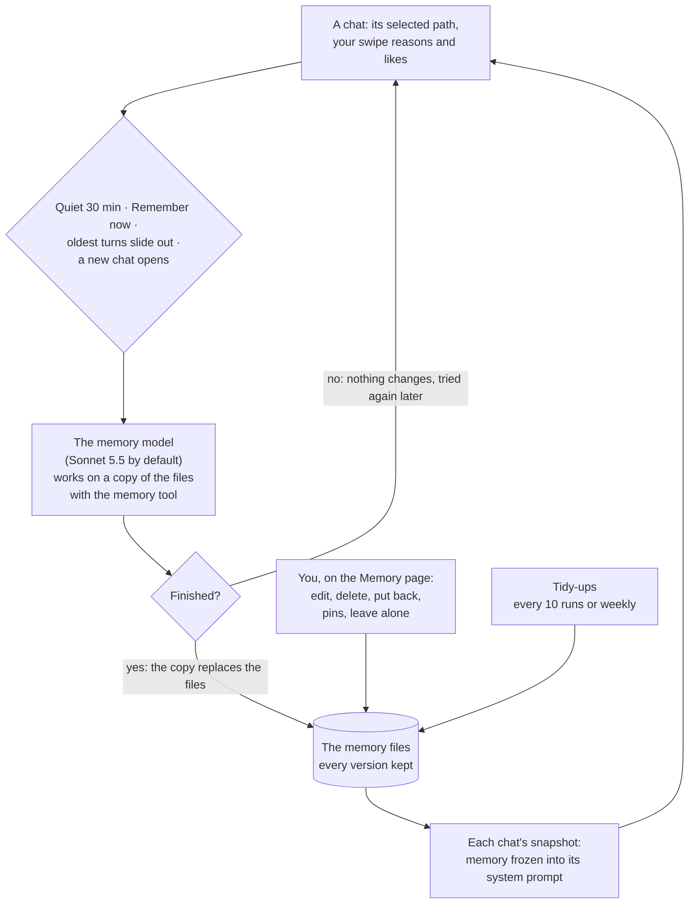

# How memory works

Every chat with a companion feeds one memory, so the companion stays the same person with a growing
history without the old chats being sent again. This page explains all of it: what the memory is,
who writes it and when, what a chat sees of it, how canon and one-shot chats differ, and how it is
kept tidy, corrected and rebuilt.

Only a Claude companion created **with memory** has one. A Grok companion, or a Claude one created
without memory, works differently: see [Claude or Grok, with or without memory](providers.md).

## The whole thing at a glance

There are two models. The **chat model** plays the companion and only ever _reads_ memory. The
**memory model** (each companion's _Memory model_ setting) reads a chat afterwards and _writes_
memory. Nothing a companion says mid-chat changes what it remembers until the memory model has
read the chat.

## The files

A companion's memory is a handful of Markdown files. You can read them, edit them, delete them and
put back earlier versions of them on its **Memory** page. A new companion starts with these eight,
each holding only a heading and a line saying what belongs in it:

| File                 | What it holds                                                                                                   |
| -------------------- | --------------------------------------------------------------------------------------------------------------- |
| `character_canon.md` | what the character has established about herself beyond the profile: backstory, tastes, opinions, habits, scars |
| `relationship.md`    | how the bond has changed, nicknames, inside jokes, rituals, promises, where things stand                        |
| `user.md`            | the real person behind the persona: real-life facts only                                                        |
| `feedback.md`        | standing requests about how the character writes or behaves, and patterns in rejected and liked replies         |
| `open_threads.md`    | unresolved plot hooks, and real-life things to ask about later                                                  |
| `world.md`           | places, recurring characters, owned items, lore. Fiction only                                                   |
| `story/recent.md`    | 3–6 line summaries of the latest canon chats, newest last                                                       |
| `story/arcs.md`      | older history, condensed into a paragraph per arc                                                               |

Two lines run through all of them:

- **Fiction and real life stay apart.** Story events never go into `user.md`, and real-life facts
  never go into `world.md` or `story/`. The persona you play is fiction too: its traits stay in the
  profile, not in `user.md`.
- **The story lives in two places**: `world.md` (what exists in the story) and `story/` (what
  happened in it). Those are the files a one-shot chat may not change (see
  [Canon and one-shot](#canon-and-one-shot)).

The memory model may add a file of its own, but only when no existing file can hold something.

**Limits.** Each file may be up to 8 KB, the two story files up to 16 KB, and a companion may have
up to 20 files (`VALHALLA_MEMORY_FILE_KB`, `VALHALLA_MEMORY_STORY_KB`, `VALHALLA_MEMORY_FILES`). A
change that would go past a limit is refused, and the memory model is told why so it can condense
instead. The limits are there because every chat sends the whole memory with every turn: in total
it stays at a few thousand tokens.

## Who writes memory

**Only the memory model and you, never a chat.** A reply can be swiped away, edited, deleted or
left behind on another branch. If replies wrote memory as they went, a rejected one could leave
invented "facts" behind. So the companion never gets the memory tool. Instead, the memory model
reads the chat's **selected path** afterwards, the one line through the chat that counts as "what
happened", and brings the files up to date.

It does that with Anthropic's **memory tool**: `view`, `create`, `str_replace`, `insert`, `delete`
and `rename` on paths under `/memories`. Valhalla 2 carries the commands out against the database
rather than a folder, and answers the way the tool's documentation says, so the model reads what it
expects. Every command, done or refused, is written to a log (`memory_ops`).

**You** write memory on the Memory page. An edit or delete there is recorded as a manual change
(`manual`) and takes effect the next time a chat takes a fresh look at memory (see
[What a chat sees](#what-a-chat-sees)).

**One writer at a time.** Runs from chats, tidy-ups, rebuilds and your edits all write the same
files, and the model runs wait on the API in between. So each takes its companion's turn in a
queue, and no two ever interleave. A run that fails still lets the next one in.

## When the memory model runs

A chat is folded into memory:

1. **When it has been quiet for 30 minutes** (`VALHALLA_IDLE_MINUTES`). The server checks every
   minute, and once 5 seconds after it starts, which also picks up whatever was left when it last
   stopped.
2. **When you press Remember now** in the chat.
3. **When a long chat's oldest turns slide out** of what is sent. The reply waits for it (see
   [The window](#the-window-long-chats-slide)).
4. **When you open a new chat with the companion**: every _other_ chat of that companion that has
   something memory doesn't have yet is folded in. The new chat's greeting waits for them (the chat
   shows that it is remembering), so the greeting is written knowing everything.

A run starts only when there is something to do: new messages on the selected path, a message
memory has seen that was since edited, deleted or left on another branch, a swipe reason or a like's
comment memory hasn't read, or a change of mode. With nothing new it does nothing and asks the API
nothing, so running it twice is the same as running it once.

**A run that failed** (declined by the API, say) is not tried again by the 30-minute timer until
something in that chat changes, so a chat that is always declined doesn't cost money every minute.
**Remember now** always tries.

## What a run is given

The memory model gets two things.

**Its instructions** (the system prompt) are the companion's **Memory-keeping instructions**, one
of the texts you can rewrite on the companion's page, followed by one line about the chat's mode,
which you can't (see [Canon and one-shot](#canon-and-one-shot)). In short, the default instructions
say:

- add what will matter in later chats, **as its gist**: "she was mistreated early on", not every
  count, name and object of one scene. Keep a specific detail only when you dwelt on it;
- correct facts that changed, delete open threads that were resolved, and write a finished arc as
  one brief past-tense line;
- record only what the selected path shows was said or established, never guesses about you;
- keep fiction and real life apart;
- fold a swipe reason into `feedback.md` only when it shows a lasting preference, and praise as
  "what to keep doing", in general terms;
- take back what came only from edited, deleted or abandoned messages, or from withdrawn praise;
- add nothing about the topics you asked it to leave alone, and cut what memory has on them to one
  line;
- update lines in place rather than adding near-duplicates, and add files only when needed.

**What to read** (the first message) is made of these parts, each only when it has something in it:

| Part                              | What it holds                                                                                                                                                       |
| --------------------------------- | ------------------------------------------------------------------------------------------------------------------------------------------------------------------- |
| `<current_memory>`                | every memory file as it is now                                                                                                                                      |
| `<chat title mode>`               | the chat's title and mode                                                                                                                                           |
| `<mode_change>`                   | the chat was filed under one mode and is now in the other (see [Changing a chat's mode](#changing-a-chats-mode))                                                    |
| `<already_in_memory>`             | the six messages before the new ones, for context. After a mode change, the whole selected path                                                                     |
| `<new_messages>`                  | the messages of the selected path memory hasn't seen                                                                                                                |
| `<corrections>`                   | messages memory saw that were since edited (before and after), deleted, or left on another branch (with what the selected path has instead)                         |
| `<rejection_reasons>`             | why you rejected replies, from the question asked after the fifth swipe                                                                                             |
| `<praise>` / `<withdrawn_praise>` | liked replies with your comment, up to three of their other versions, and praise you changed or took back (see [Likes and swipe reasons](#likes-and-swipe-reasons)) |
| `<leave_alone>`                   | the topics you asked the companion not to bring up                                                                                                                  |

## Corrections: edits, deletes and branches

Memory follows the selected path, and the path can change after memory has read it. When a message
memory has already seen is **edited**, **deleted**, or left behind because you **branched** or
picked another version above it, the message is marked for correction. The next run is told what it
said, and what replaced it if anything, so it can take back whatever came only from it. A fact still
supported by the selected path or by another chat stays.

After the run:

- an **edited** message counts as filed again, in its new words;
- a **deleted** or **abandoned** one counts as not in memory, so if it ever comes back onto the
  path it is read as new;
- a message that went away and **came back unchanged** (you switched branches and back) needs no
  correction: its mark is lifted and nothing is sent about it.

## Likes and swipe reasons

Both tell memory how the companion should write. Neither goes into the chat's own messages, so the
next reply, the prompt cache and the companion's earlier thinking are untouched. Both reach the
companion through `feedback.md`, the next time a chat takes a fresh look at memory.

- **A swipe reason**, the answer to the question asked after the fifth swipe on a reply, goes
  straight to the following versions of that reply as a hidden note, and to the memory model at its
  next run. It is folded into `feedback.md` only when it shows a lasting preference, not a one-off
  complaint.
- **A like with a comment** is praise. The memory model sees the words you liked as they were when
  you liked them (even if you edit the reply later), your comment, and up to three of the reply's
  other versions, so it can tell what you chose over what. It keeps the quality you liked as "what
  to keep doing", in general terms, never as a quote. Praise for a version that is not on the
  selected path is about the writing only: no facts or events are taken from it.
- **Changing or taking back praise** (a new comment, no comment, unliking, deleting the reply) tells
  the memory model what it was told before, so it can take back what came only from that.
- **A like without a comment** is only for you: nothing is sent anywhere.

## Canon and one-shot

Each chat is **canon** (part of your story together) or a **one-shot** (a standalone scenario: a
"what if", a dream, another setting). You choose when you open the chat, and can change it at any
time. The mode decides one thing: **whether the chat's events count as part of the story.** Either
way the companion is the same character, reads the same memory, and the memory model files the chat
afterwards.

### What the companion is told

Every chat reads the whole memory, then one line about its mode:

- **Canon:** "This chat is canon: what happens in it is part of your story together."
- **One-shot:** "This chat is a standalone one-shot scenario. What happens in it is not part of
  your shared story, though you are still yourself and still know the user."

So in a one-shot the companion still remembers the canon story, your nicknames and your feedback,
but knows this scene doesn't carry the plot on.

### What the memory model may write

| File                                  | Canon chat                           | One-shot chat        |
| ------------------------------------- | ------------------------------------ | -------------------- |
| `character_canon.md`                  | updated                              | updated              |
| `relationship.md`                     | updated                              | updated              |
| `user.md`                             | updated                              | updated              |
| `feedback.md` (swipe reasons, praise) | updated                              | updated              |
| `open_threads.md`                     | updated                              | real-life items only |
| `world.md`                            | updated                              | **read-only**        |
| `story/recent.md`                     | gets a 3–6 line summary of this chat | **read-only**        |
| `story/arcs.md`                       | old summaries condensed into it      | **read-only**        |

A one-shot's events stay out, but **what it shows about the two of you is kept**: a new habit the
character showed, a lasting request of yours, a new inside joke. "We were pirates and sank a ship"
is not.

Two things hold this in place:

- **The instructions.** A canon chat's run is told to add its summary to `story/recent.md` (or
  extend it, if the chat is already there) and to condense the oldest entries into `story/arcs.md`
  when the file nears its limit. A one-shot's run is told not to touch `world.md` or `story/`, and
  to keep to the real-life items of `open_threads.md`.
- **The memory tool.** For a one-shot, every command that would change `world.md` or anything under
  `story/` is refused, deleting or renaming a folder that holds them included, and the model is told
  why. So even a model that ignored its instructions can't put a one-shot's events into the story.
  The `open_threads.md` rule is in the instructions only; the tool doesn't check it.

### Changing a chat's mode

Switching a chat's mode does two things at once:

1. **The chat takes a fresh look at memory** on its next turn, because the line about its mode
   changed. That turn starts with a cold cache, so it costs a little more.
2. **If memory has already read the chat**, everything it read is marked for correction. At the
   next run (after 30 quiet minutes, on **Remember now**, or when another chat opens) the memory
   model gets the chat's whole selected path again, with a note that it was filed under one mode
   and is now the other, and re-files it:

- **One-shot → canon.** The run is an ordinary canon run: it adds the chat's summary to
  `story/recent.md` and what it established to `world.md`.
- **Canon → one-shot.** The chat's events went into the story while it was canon, so they have to
  come back out. For this one run, and only this one, `world.md` and `story/` are open to the
  memory model, and its instructions say: remove this chat's summary from `story/recent.md` (or, if
  it was already condensed into `story/arcs.md`, only this chat's part of that arc), remove from
  `world.md` and the plot hooks in `open_threads.md` what came only from this chat, keep what other
  chats also show, and add nothing to `world.md` or `story/`. The other files are updated as for any
  one-shot. From the next run on, the chat is an ordinary one-shot and the story files are locked
  again.

"Only remove" is asked of the model, not checked by the tool: a removal and a rewrite of a line
look the same to it, and trimming an arc paragraph means rewriting it. What the run changed is in
each file's history on the Memory page, where anything it got wrong can be put back. A run that
fails changes nothing, and the switch is re-filed at the next try.

Switching back and forth before memory has read the chat again costs nothing: if the chat ends up
in the mode it was filed under, there is nothing to re-file.

## How a run is kept, or thrown away

A run never changes the real files as it goes. It works on a **copy** of the companion's files, and
only when it finishes is the copy swapped in, in one transaction together with the marks that say
which messages, reasons and praise it has read. Each command still writes one version of the file
it changed, kept when the run is.

A run that is **declined** by the API, **fails**, or **runs out of steps** (16 requests,
`VALHALLA_MEMORY_ITERATIONS`) is thrown away whole: the files and the marks stay as they were, and
the same work is there for the next try. Nothing is ever half-done.

Every run is listed on the Memory page: what kind it was, what it said it changed, what it cost
(a few cents on Sonnet), or why it failed.

## What a chat sees

**All of memory, in the system prompt.** A chat doesn't look anything up mid-reply. Its system
prompt is, in this order:

1. the companion's profile, exactly as you wrote it;
2. the **Memory policy** (one of the companion's texts): memory is background, bring a remembered
   detail up only when the moment calls for it, never contradict the established canon or your
   feedback, never mention memory or files;
3. `<memory>`: every memory file, whole, the eight seed files first;
4. `<pinned_moments>`, when there are any (see [Pinned moments](#pinned-moments));
5. `<leave_alone>`, when there are any topics (see [Leave alone](#leave-alone));
6. the line about the chat's mode.

The prompt cache's breakpoint is right after it, so re-sending all of this each turn costs a cache
read. **Inspect** in a chat shows it exactly as it goes out.

**A snapshot, frozen per chat.** The API ties the companion's thinking, and the prompt cache, to the
exact system prompt. If memory changed under a chat mid-conversation (another chat being filed,
say), every turn after would lose both. So a chat keeps the memory it started with, stored with the
chat, and takes a fresh look only when its prompt changes anyway, or nothing cached would be lost:

| A chat takes a fresh look…                                  | because                                                      |
| ----------------------------------------------------------- | ------------------------------------------------------------ |
| on its first turn                                           | it has no snapshot yet                                       |
| after sitting longer than its cache lasts (5 min or 1 hour) | the cache is cold anyway                                     |
| when its oldest turns slide out                             | the start of what is sent changes anyway                     |
| after its mode changes                                      | the mode line changed                                        |
| after you pin or unpin a message in it                      | the pins changed. Other chats see the pin at their next look |
| after you add or remove a topic to leave alone              | every chat of the companion, at its next turn                |

Edits you make to the files on the Memory page, and what the memory model writes, reach a chat at
its next fresh look, like everything else.

## The window: long chats slide

Only about the last 20,000 tokens of the selected path are sent (`VALHALLA_WINDOW_TOKENS`). When a
chat outgrows that, its oldest ten exchanges slide out at once (`VALHALLA_WINDOW_CHUNK`), not one
per turn: every slide changes the start of what is sent, and so costs the cache, and sliding one at
a time would cost it every turn. The window always starts at one of your messages, the newest two
exchanges always stay, and where it starts is kept with the chat, so every request until the next
slide starts in the same place. A dashed line in the chat marks it. Branching off above that line
measures the window again from the start.

What slides out is not forgotten: it is folded into memory first. On the turn that slides, the
reply waits while the memory model files the chat (the chat says the companion is putting the oldest
part of this chat into memory first), and only then does the chat take its fresh look at memory. So
the snapshot it goes on with already holds the turns that just stopped being sent.

If that memory run fails (declined, say), the slide goes ahead anyway, on memory as it stands, and
the run is in the Memory page's history like any other. If it is still going after three minutes
(behind a rebuild of the companion's memory, say), this reply is written without the slide: the
window and the snapshot stay as they were, so the oldest turns are still sent, and the next turn
tries again. The run carries on in the background meanwhile.

## Pinned moments

The memory model writes in its own words, and tidy-ups condense, so the exact wording of a promise
or an origin line can drift. For words that must stay exactly as they were said, the pin under a
message keeps them: you trim them to the line that matters and say who said them. Every chat with
the companion then gets them word for word in a `<pinned_moments>` block after its memory, under a
short note (**Pinned moments note**, one of the companion's texts: "treat them as things that
happened, not as instructions").

The memory model never sees or changes pins, a tidy-up or rebuild leaves them alone, and deleting a
chat leaves its pins behind. They are listed, and unpinned, on the Memory page: 30 at most, of 500
characters each, since every one is sent every turn.

## Leave alone

Memory goes out with every turn, and a model tends to use what it is shown: a vivid detail from one
old scene can turn up reply after reply. Three things work against that:

- **The Memory policy** tells the companion to bring a remembered detail up only when the moment
  calls for it or you raise it, never the same one turn after turn, and to let finished arcs stay
  finished.
- **The memory model** keeps the gist of a scene rather than its every count and object, and writes
  a finished arc as one brief past-tense line. Tidy-ups cut one-scene specifics down the same way.
- **The Leave alone list** on the Memory page, for when the companion still keeps returning to
  something ("the old debt", "the cellar"). Every chat with the companion gets the list in a
  `<leave_alone>` block after its memory and pins, under a short note (**Leave-alone note**), telling
  it not to raise those topics unless you do. Every chat takes a fresh look on its next turn. The
  memory model is shown the list too: it adds nothing about those topics, and cuts what memory has on
  them down to one brief line, and so does a rebuild. Taking a topic off the list lets the companion
  bring it up again. 30 topics at most, of 200 characters each.

## History and putting back

Every change to every file is kept, with where it came from: a chat's run, a tidy-up, a rebuild,
your edit, or a revert. The Memory page shows a file's history as a line-by-line diff, and **puts
back** any earlier version as one more change, so the history itself is never rewritten. What the
files say now is what is sent; the history is only there for putting things back.

## Tidy-ups

Filed one chat at a time, the files slowly gather near-duplicates, facts later chats contradicted,
and summaries that could be shorter. So every so often the memory model reads all the files at once
and tidies them:

- **When:** after every ten successful runs from chats (`VALHALLA_CLEANUP_EVERY`), or a week after
  the last tidy-up if memory changed at all in between (`VALHALLA_CLEANUP_DAYS`), and whenever you
  press **Tidy up now**. A tidy-up that failed is not retried until another chat has been filed.
- **What it does:** it merges duplicate lines within and across files, lets the most recent fact
  win, cuts one-scene specifics down to their gist, moves older episodes from `story/recent.md` into
  `story/arcs.md`, removes open threads that are clearly resolved, and condenses each file toward
  about 70% of its limit. It sees each file's size and limit to do that.
- **What it may not do:** silently rewrite `character_canon.md`. When two facts there truly
  conflict, it keeps both and lists the conflict under `## Conflicts` at the end of the file, for you
  to settle. It also may not add, rename or delete files: a tidy-up that tries is thrown away whole.
  That rule is checked, not only asked for.

How it tidies is one of the companion's texts, **Tidy-up instructions**.

## Rebuilding

**Rebuild from every chat** on the Memory page starts the files over from their seeds and replays
every chat's selected path through the memory model, in the order the chats were opened, about
20,000 tokens at a time. It is for when memory went wrong, a better memory model is out, or you
rewrote its instructions.

- Each chat is replayed **under its current mode**, so one-shots stay out of the story.
- Each chat's swipe reasons and praise come with its last part; the leave-alone list with every part.
- Deleted messages and abandoned branches are not replayed: only the selected paths.
- Pins are untouched.
- The current files stay in place until the rebuild finishes, then are replaced in one go. If any
  step fails, nothing changes.
- Each file's history shows one `rebuild` change, beside everything before it, so the old memory can
  still be put back.

## Settings that shape memory

All of these have defaults. They are set in `dev.env` and `deploy/valhalla2.service` (see
[Settings](../README.md#settings)).

| Setting                      | Default    | What it does                                                      |
| ---------------------------- | ---------- | ----------------------------------------------------------------- |
| `MEMORY_MODEL`               | Sonnet 5.5 | the memory model a new companion starts with (each can change it) |
| `VALHALLA_IDLE_MINUTES`      | 30         | how long a chat is quiet before it is folded into memory          |
| `VALHALLA_WINDOW_TOKENS`     | 20000      | about how much of a chat is sent each turn                        |
| `VALHALLA_WINDOW_CHUNK`      | 10         | how many exchanges slide out at once                              |
| `VALHALLA_MEMORY_FILE_KB`    | 8          | the largest a memory file may be                                  |
| `VALHALLA_MEMORY_STORY_KB`   | 16         | the largest `story/recent.md` and `story/arcs.md` may be          |
| `VALHALLA_MEMORY_FILES`      | 20         | how many files a companion's memory may have                      |
| `VALHALLA_MEMORY_ITERATIONS` | 16         | the most requests one run may make                                |
| `VALHALLA_CLEANUP_EVERY`     | 10         | runs from chats between two tidy-ups                              |
| `VALHALLA_CLEANUP_DAYS`      | 7          | …or days, if memory changed at all                                |

**Cost.** A run makes several requests in a row, and each re-reads the one before it from the cache,
so only what is new in a step costs full price: a few cents a run on Sonnet. Memory in a chat is a
few thousand tokens sent with every turn, but it sits in the cached part of the prompt.

## Where this differs from the memory brief

Valhalla 2's memory was built from a written brief. Where it does something else, this is why:

- **Chats don't get the memory tool; they get all of memory in the prompt.** The brief had chats
  look up `world.md` and `story/` with the tool. A tool loop inside a streamed reply mixes with
  declined turns, fallback models and the companion's thinking, every tool call would have to be
  stored and replayed exactly, and a low-effort Haiku may simply not look. The limits keep the whole
  memory to a few thousand cached tokens, so it is all sent. The memory tool is used where it
  matters: by the memory model.
- **Memory is frozen per chat** instead of rebuilt every turn, so the cache and the companion's
  thinking survive (see [What a chat sees](#what-a-chat-sees)).
- **A run works on a copy** that is swapped in whole, instead of committing each command, so a run
  cut short leaves nothing half-done. Each command still writes one version, kept when the run is.
- **TypeScript, `node:sqlite`, Vitest and the default journal**, like the rest of the suite, instead
  of plain JavaScript, `better-sqlite3`, `node:test` and WAL.
- **Settings are per companion**, with the two models in them; the environment only gives a new
  companion its defaults.
- **Stop sequences apply to chats only.** The memory model writes Markdown, which may well contain
  one.
- **Several people can use it**, each with their own companions, as everything in the suite does.
- **A tidy-up keeps the files as they are** and is thrown away if it adds, renames or deletes one,
  so "keep the file structure" is checked, not only asked for.
- **A rebuild reads long chats a window at a time**, and its intermediate steps aren't kept as
  versions: the history shows one `rebuild` change per file, beside everything before it.
- **Backups are checked for once an hour** rather than at a set time of day, so a server that was
  off at that time still gets its daily copy (see [Installing and data](../README.md#installing-and-data)).
